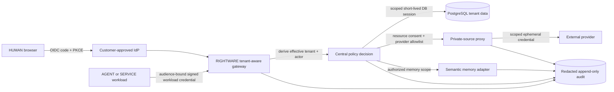

# RIGHTWARE Shared Intelligence — G04-00 Identity, Tenancy & Privacy Architecture R0

**Date:** 2026-11-14 Africa/Maputo. **State: ARCHITECTURAL PROPOSAL / NOT RATIFIED.**
**Repo baseline:** `develop@072f7f4a5922eab105dc2d063a376c9a8a7c974c` · [CI 43607079915](https://github.com/rightware-corporations/rightware-shared-intelligence/actions/runs/43607079915) SUCCESS, 216 tests, 8 migrations, G01 synthetic live GitHub and native logical restore.

## 0. Boundary and objective

The objective is to evolve a **single-organization, local synthetic pilot** into a defensible future multi-tenant product **without deploying a production service now**. The G01 authorization and verification layer remains LAB-only, disabled by default. G04 is not authorization to expose private sources, issue external credentials, deploy staging to the Internet, or transition tasks to DONE. G04 proposals do not modify policy or create binding corporate decisions.

### Source-backed code audit (VERIFIED IN REPO; external traffic not audited)

| Existing element | Directly observed | Production gap |
|---|---|---|
| Human/service credentials | `api_auth.py` resolves one SHA-256 high-entropy bearer against `si_api_tokens`; expiry and revocation are checked. `token_admin.py` issues/revokes tokens offline | No external identity issuer, audience, workload federation, proof of possession, device/session revocation model or enterprise SSO |
| Organization, projects, principals | `0001_work02_core.sql` has `si_organizations`, project→organization, globally keyed `si_principals`, project-permission grants | No scoped org membership with verified identity, tenant-bound grants/version epochs, source-resource decisions, RLS |
| API access | `http_api.py` authenticates actor via bearer dependency and project is path parameter; `WorkCore._authorize` checks project grant | A valid grant is not sufficient for source consent, resource ACL, tenant residence or data-class policy; no generalized per-resource enforcement |
| G01 policy lifecycle | `policy_lifecycle.py` uses two HUMAN bearers, independent SERVICE, append-only lifecycle + task row locks; G01 flag only for `/rw_test` lab | These are internal synthetic identities, not customer federation or source authorization |
| Memory | `context_service.py` derives org/project from authenticated project grant and validates returned Mem0 scope; memory items are UNVERIFIED | `MemoryScope.mem0_user_id` is a namespace string, not independent Mem0 authorization. Local Mem0 shim accepts scope selected by trusted caller under one shared X-API-Key |
| Secrets / outbound integration | G03 GitHub provider token is server-only; Mem0 local service uses one lab key and loopback | No workload identity, per-tenant source tokens, scoped secret retrieval, rotation, per-tenant encryption-key or audited egress policies |
| CI and recovery | 216/216 tests PASS with synthetic PostgreSQL native logical restore and a live public pinned GitHub run | No production failover/PITR, RPO/RTO, branch protection, incident and privacy readiness |

## 1. Proposed trust-boundary design (NOT IMPLEMENTED)

**Untrusted boundaries:** all inbound HTTP headers, URL IDs, JSON, OIDC claims not yet validated, agent prompts, tool outputs, source content, Mem0 results, GitHub API replies and recovered backup contents. **Trusted only after verification:** issuer/JWKS/signature/audience/expiry/jti/nonce binding as applicable; DB active tenant membership; typed resource grants; source consent and provider scope; event generation and revocation state.

## 2. Proposed identity contracts

**HUMAN:** OIDC Authorization Code + PKCE, issuer and audience allowlists, short-lived app session, no browser storage of provider or workload keys, session-bound state/nonce, session revocation, MFA/step-up for approver, source consent and break-glass. External IdP selection remains OPEN.

**SERVICE/AGENT:** noninteractive workload federation with asymmetric signing and narrow audience (e.g., OIDC workload token exchange, or mTLS-bound/attested service identity). Each agent execution binds `actor_id`, `tenant_id`, `project_id`, deployment/workload identity, permitted actions, expiration and jti. No reusable static `rwsi_` credential as a production default; no agent self-asserting HUMAN or elevating to policy approver. Pick exact issuer/mTLS technology only after threat model and infrastructure decisions.

**IdentityContext (recommended internal immutable type):** `subject_id`, `issuer_id`, `subject_kind`, `organization_id`, `project_id|null`, `auth_time`, `session_id|workload_id`, `credential_id`, `credential_generation`, `assurance_level`, `audience`, `expiry`, `trace_id`. Construct server-side only after verification and DB lookup, never accept as trusted JSON.

**Tenant binding:** map external `(issuer,sub)` to internal principal independently of display names. Resolve active membership, tenant organization, project grant, resource grant and consent version from PostgreSQL. Tenant switching requires new authorization decision, not changing path/header. A principal may belong to several organizations, but one request has exactly one validated effective tenant; ambiguous contexts deny.

**Separation of duties:** policy author, independent HUMAN approver, SERVICE verifier, HUMAN reviewer, security operator, privacy operator and platform operator are distinct authorities. A global platform operator never implicitly inherits tenant source read rights. Every break-glass operation requires explicit emergency scope, secondary sign-off, short TTL and auditable disclosure.

## 3. Authorization decision and enforcement

**Authorize(ctx, action, resource, purpose, requested_projection) → ALLOW or DENY + evidence receipt**. Server-derived inputs: validated identity, active tenant membership, org/project lineage, resource ownership, role/action grants, immutable resource policy version, source grant/consent, data class/purpose, expiry/revocation, processing location and retention constraints. Default DENY on absent metadata, conflicting grants, inactive org, expired consent, tenant mismatch or DB/policy outage.

Enforce at **each resource-bound entry point and write/read**, not only at project membership: REST, MCP, background jobs, memory retrieval/insertion, export, delete, GitHub/source proxy, caches, embeddings, audit queries and backup restore. Treat `project_id` in URL as requested resource, never as authority.

Recommended DB defense in depth: organization+project composite constraints on all tenant-bearing tables; transaction-local vetted tenant context and PostgreSQL RLS policies under runtime roles with no BYPASSRLS; no direct client-settable tenant session variable. Define service roles and migrations in a separate approved phase; current schema has no RLS. Audit all cross-tenant FK chains before migration.

Resource authorization should return only allowed fields; guard against property-level exposure, not just object-level access. An opaque identifier or UUID is not evidence of permission. Authorization decisions are reevaluated at commit after external calls, tenant transfer, key rotation and policy revocation.

## 4. Private source and external provider contract

**Default deny** private providers and credentials until explicit organization approval, principal authorization, source registration, allowed purpose/scope, owner of authorization, expiration, residency/retention classification, revocation path, audit event and security review. Store a *reference* to secret in vault, never in task, Mem0, URLs, event payloads or GitHub logs. Fetch short-lived installation/scoped tokens on the server only.

Network protections: provider allowlist, no arbitrary URL fetch by agent, no HTTP redirects to untrusted origins, DNS/IP checks on resolution and connection, restrictions on private/metadata IP ranges, egress firewall, TLS certificate validation, bounded timeouts/responses, bounded concurrency, retries with jitter and provider-specific scopes. The R2 GitHub synthetic pinned-run flow is NOT generic private-repository permission.

## 5. Semantic memory & data governance

Maintain separation of **authoritative PostgreSQL facts** from **UNVERIFIED semantic candidate content**. A `rw:<org>:<project>` namespace alone cannot be the provider-side tenant access check. For private tenant data, require gateway identity binding, internal Mem0 request signing/binding, server-side resource filters, collection isolation strategy, provenance and deletion graph (source payload, embeddings, index, cache, exports, backups, audit receipt). Check the access policy **both before retrieval and before returning** semantic candidates.

Data categories to classify before ingestion: identifiers and account data; operational tasks/evidence; provider source content; generated observations; embeddings/memory; immutable event receipts; logs/telemetry; backups. For each category, record controller/processor, purpose, legal basis/consent if applicable, storage country, subprocessor, encryption owner, access principals, retention clock, deletion propagation, export semantics, recovery exception and policy owner. **No retention duration or jurisdiction is approved by this document.**

Immutable audit vs privacy: keep only minimal non-reversible references and security-relevant metadata in append-only records, never raw content/secrets. Deletion may erase payload and derived embeddings while retaining permitted minimal audit facts according to a later legal policy. Test restore-then-redelete so backup resurrection cannot silently undo a deletion request.

## 6. Deployment profile and separation from G05

**Internal LAB:** current G01 flags and local rw_test; synthetic public GitHub only. **Future STAGING (recommendation only):** private ingress with synthetic fake organizations; approved IdP test tenant, isolated DB/cache/embedding collections, fake secrets and source simulators, forced failures. **PRODUCTION:** blocked until G04 ratification, technical gates, red-team and independent signoff, G05 release review, branch protection, secrets/process controls and legal/privacy decisions.

## 7. Proposed implementation sequence, no code authorization inferred

1. **G04-A0** freeze threat model, ownership, architecture and tenant identity baseline; ratify decisions D01–D12 below.
2. **G04-A1** identity provider, principal mapping, signed credential validation, lifecycle/revocation/step-up, bound workloads; test forged/mixed issuer cases.
3. **G04-A2** tenant/org/project membership, resource authorization engine, DB composite FKs/RLS, tenant migration strategy; prove horizontal/vertical denial.
4. **G04-A3** private-source registration, consent and resource ACL, provider adapter + egress sandbox; prove revoke-before/during fetch.
5. **G04-A4** semantic memory provenance, scoped service-to-service auth, deletion propagation and backup resurrection protection.
6. **G04-A5** limits, logging, audit integrity, SIEM/alerts, incident playbooks, secret rotation, resilience and RPO/RTO evaluation.
7. **G04-A6 / G05** independent staging security acceptance; never deploy to customers or production on a green lab CI alone.

## Source and standard references (guidance, not automatic compliance)

- [OWASP API Security Top 10 2023](https://owasp.org/API-Security/) — authorization and authentication failure modes.
- [IETF RFC 9700 (2025), OAuth 2.0 Security BCP](https://www.rfc-editor.org/rfc/rfc9700.html) — PKCE, redirect strictness, secure client authentication.
- [NIST SP 800-63-4 Digital Identity Guidelines](https://pages.nist.gov/800-63-4/) — identity assurance, authentication and federation.
- [OpenID Connect Core 1.0](https://openid.net/specs/openid-connect-core-1_0.html) — validated federated sign-in semantics.

**Status:** G04 DRAFT; no database migrations, new endpoints, private-source authorization or product-release approval from this document.
